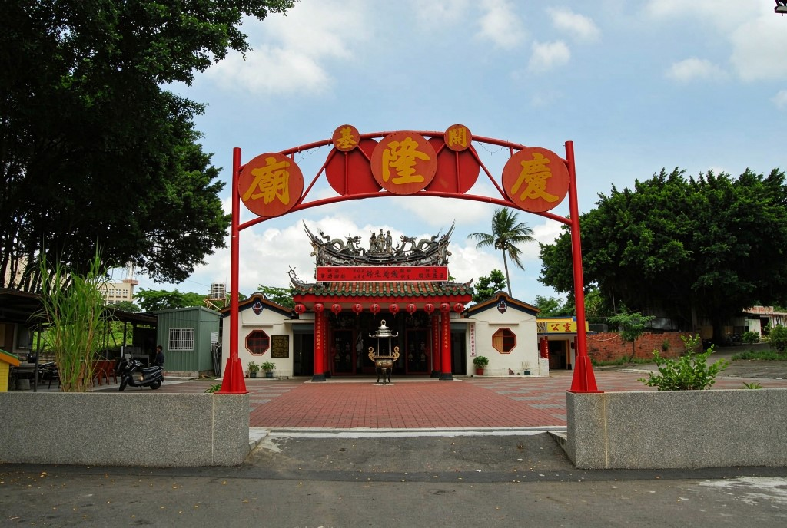

# 慶隆廟擴建預籌與參與式眾籌（中國台灣臺南市，政府核准牌位龕位，銷售收益共享）
## Pre‑launch planning and investment crowdfunding for expanding Qinglong Temple in Tainan, Taiwan, China (50,000 government‑approved memorial niches) with shared sales returns

> 專案識別 Project ID：TWN002807
> 文件版本 Document Version：v0.3
> 專案狀態 Project Status：設計徵集 Design‑solicitation Phase

---

## 中文｜Chinese

本倉庫為**中國台灣臺南市**慶隆廟擴建、祭祀樓建設、牌位產品、影視內容、平行世界APP之**開源協同設計倉庫**。
這是一個參與式共建實驗：不僅僅是籌措資金，全球參與者可以透過 GitHub Issues、Pull Requests，共同參與建築、產品、商業營運、收益分配、治理機制的設計討論。

> 備註：本專案已取得政府核准總計50000個牌位龕位額度；第一期工程預先興建16000個龕位，後續視市場與資金狀況分階段完成剩餘額度的建設。

本專案計畫擴建慶隆廟主殿，新建一座祭祀樓，第一期規劃容納16000個牌位（含人用牌位與寵物牌位）；同時開發歷史主題影視作品，以及「平行世界APP」數位紀念應用，結合實體祭祀服務與數位追思。

完整全套專案細節請查閱：**[PROJECT_DESIGN.zh.md](./PROJECT_DESIGN.zh.md)**

### 📂 貢獻方式 How to contribute
1. 先閱讀完整設計文件
2. 新增 Issue 提出想法、討論議題
3. 提交 Pull Request 貢獻文稿、流程、設計草案
> 建議貢獻前先開 Issue 確認設計方向，避免無效修改。

### ⚠️ 合規與免責聲明
本倉庫全部內容僅為社群開源設計草稿，**不構成法律意見、投資建議、要約或招攬行為**。
參與方案、回報架構、跨境資金、稅務安排以加拿大法律顧問以及中國台灣在地顧問出具之正式法律文件為最終依據。
專案面臨許多現實風險：工程進度、建築施工預算、市場需求變動、營運管理風險等，不存在任何收益承諾。
雖然已獲得政府核准50000個龕位總額度，但分階段施工、實際啟用時仍須完成後續相關檢查、驗收作業，第一期16000個為優先興建規模。

---

## English

This repository hosts open‑source collaborative design documents for the Qinglong Temple expansion, Memorial Tower construction, memorial‑tablet product definitions, film‑video content, and the Parallel‑World App located in **Tainan City, Taiwan, China**.

> Note: A total quota of 50,000 memorial niches has been government‑approved for this project. The first‑phase construction will deliver 16 000 niches. Remaining niches will be built in subsequent phases subject to market conditions and available funding.

This is a participatory co‑design experiment. Beyond capital‑raising, worldwide co‑design participants may take part in discussions over architecture, product specifications, business operations, revenue distribution and governance via GitHub Issues and Pull Requests.

The project plans to expand the main hall of Qinglong Temple and construct a new Memorial Tower. The first‑phase capacity will be 16 000 tablet niches (for human memorial tablets and companion‑animal memorial tablets). Historical‑theme film works and the Parallel‑World App for digital remembrance will be developed, combining physical memorial services with digital commemoration.

For full project specifications please refer to: **[PROJECT_DESIGN.md](./PROJECT_DESIGN.md)**

### 📂 How to contribute
1. Read the full‑length design document first
2. Open an Issue to raise ideas or start discussions
3. Submit Pull Requests for drafts, workflows and design proposals
> It is recommended to open an Issue to align on direction before submitting substantial changes.

### ⚠️ Compliance & Disclaimer

All content within this repository consists of community‑driven open‑source design drafts only. **It does not constitute legal advice, investment advice, offer or solicitation of any kind.**

Participation terms, return structures, cross‑border funding and tax arrangements are subject to final formal legal documents prepared by Canadian legal counsel and local advisers from Taiwan, China.
Multiple real‑world risks apply, including construction timelines, budget overruns, shifting market demand and operational risks. No returns or profits are promised or guaranteed.

While the overall quota of 50 000 niches is government‑approved, phased‑build roll‑out and operational activation remain subject to subsequent official inspection and acceptance procedures. 16 000 niches are scheduled for priority first‑phase construction.

---

## 倉庫導航 Repository Navigation

### 📄 核心專案設計文件 Core Project‑Design Documents
| 中文文件 Chinese Document | 說明 Description |
|---|---|
| [PROJECT_DESIGN.zh.md](./PROJECT_DESIGN.zh.md) | 完整專案開源設計文件（中文版） Full open‑source project design document (Chinese version) |
| [PROJECT_DESIGN.md](./PROJECT_DESIGN.md) | 完整專案開源設計文件（英文版） Full open‑source project design document (English version) |

### 🤝 社群協作貢獻指引 Community Contribution Guidelines
| 文件 Document | 說明 Description |
|---|---|
| [CONTRIBUTING.md](./CONTRIBUTING.md) | 社群參與、Issue / Pull Request 貢獻規範、版權約束 Rules for community participation, Issue & Pull Request workflow, copyright terms |

### 🖼️ 圖片與多媒體素材 Image & Media Assets
| 目錄 Directory | 說明 Description |
|---|---|
| [`assets/`](./assets/) | 存放廟宇照片、建築草圖、產品示意圖、標誌素材；**所有圖片統一放置此處，使用相對路徑引用** Stores temple photos, architectural sketches, product mock‑ups and branding assets. All images shall be referenced via relative file paths. |

### 📑 待補充草案目錄 Draft‑Work Directory
| 目錄 Directory | 說明 Description |
|---|---|
| [`docs/`](./docs/) | 預留，後續放置預算草案、治理規範、審計流程等補充文檔，目前尚在建立階段 Reserved for future supplementary drafts: budget, governance rules, audit workflows. Work‑in‑progress. |

> 💡 使用提示 Usage Tip
> - 所有 Markdown 文件使用 UTF‑8 編碼；素材檔名禁止中文、空格。
> - 正式文件不要使用外部臨時圖床鏈接，圖片統一托管於本倉庫 `assets/`。
> - 若要提交修改，優先開 Issue 討論方向，再提交 Pull Request。
>
> All Markdown files use UTF‑8 encoding. Asset filenames must avoid Chinese characters and spaces.
> Do not use external temporary image‑hosting links for official documentation; store images inside this repository under `assets/`.
> For modifications: open an Issue for alignment before submitting a Pull Request.

---

維護者 Maintainer：慶隆廟擴建專案設計組 / Qinglong Temple Expansion Project Design Group
聯絡渠道 Contact：GitHub Discussions / GitHub Issues
授權 License：待確認 To‑be‑determined
